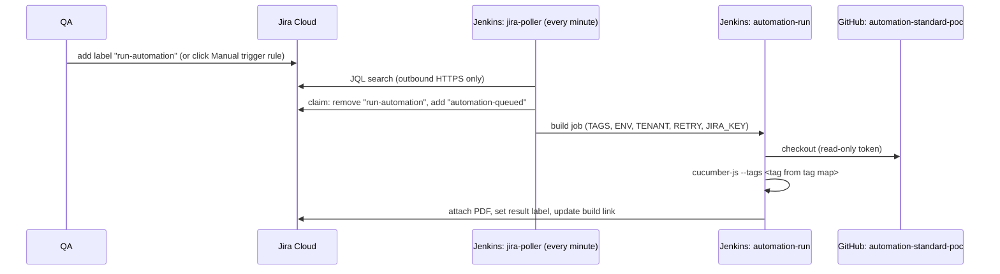

# jira-jenkins-bridge

Local, free proof of concept: **a QA engineer triggers automated tests from a Jira ticket and the result comes back on that same ticket.**

This repo is the *platform side* (Jenkins in Docker, config-as-code, Jira poller job, optional webhook service).
The test framework and reporting scripts live in the companion repo
[`automation-standard-poc`](https://github.com/SandhiyaGiri/automation-standard-poc).

> Synthetic data only. The system under test is a public demo todo app. No company systems, credentials or data are used.

## How it works



Two trigger routes exist, both start the same `automation-run` job:

| Route | Needs inbound access? | Status |
|---|---|---|
| **Polling** (`jira-poller` job) | No - Jenkins only makes outbound calls | Default, tested |
| **Webhook** (`webhook/` FastAPI service) | Yes - Jira Cloud must reach it (tunnel / gateway) | Built and tested locally, not exposed |

## What the ticket shows after a run

| Where | What |
|---|---|
| Labels | exactly one of `automation-passed`, `automation-failed`, `automation-error` (latest run) |
| Links | `Automation #10 - FAILED (0/1 passed)` -> Jenkins build (updated in place) |
| Attachments | `KAN-3-build-10.pdf` (one per run) |
| Comments | nothing by default; set `JIRA_COMMENT=true` for a full summary comment |

`automation-error` means the run produced no usable result (for example zero scenarios matched the tag).

## Prerequisites

- Docker with Compose v2 (engine running)
- A Jira Cloud site (Free plan is enough), one project, 3 issues
- A Jira API token (classic "Create API token", not the scoped variant) for the account that owns the issues
- A GitHub fine-grained token, **read-only**, `Contents: read` on `automation-standard-poc`

## Quick start

```bash
cp .env.example .env        # fill in real values, never commit .env
docker compose up -d --build
# open http://localhost:8080  -> user "admin", password = JENKINS_ADMIN_PASSWORD from .env
```

`.env` keys:

| Key | Purpose |
|---|---|
| `JENKINS_ADMIN_PASSWORD` | Jenkins admin login |
| `JENKINS_WEBHOOK_PASSWORD` | `webhook` user (read + build only), used by the optional webhook service |
| `WEBHOOK_SECRET` | shared secret for `POST /webhook/trigger` (webhook service only; Jenkins never receives it) |
| `GITHUB_PAT` | read-only token Jenkins uses to clone the tests repo |
| `TESTS_REPO_URL` | tests repo URL |
| `JIRA_BASE_URL`, `JIRA_EMAIL`, `JIRA_API_TOKEN` | Jira REST credentials (stored as Jenkins credentials) |

> First start on a fresh volume: if `jira-poller` is missing from the job list, run `docker compose restart jenkins` once.

### Jira setup (once)

1. Create a project and issues; put their keys in `config/jira-tag-map.json` of the tests repo (`KAN-1 -> @TODO-ADD`, ...).
2. Create the QA button: **Project settings -> Automation -> Create rule** -> trigger **Manual trigger** named `Run automation` -> action **Edit issue** -> Labels: add `run-automation`.
3. Optional reaction rule: trigger *Issue updated*, condition *labels contains `automation-failed`* -> transition / notify.

### Try it

Add the label `run-automation` to a mapped ticket. Within about a minute: a build appears in Jenkins, then the ticket gets a PDF, a result label and a build link.

## Layout

```
docker-compose.yml          jenkins + optional webhook (ports bound to 127.0.0.1)
jenkins/Dockerfile          Jenkins LTS (JDK 17) + Node 20 + Chromium OS libs + plugins
jenkins/casc.yaml           Configuration as Code: users, permissions, credentials, jobs
jenkins/plugins.txt         plugin list
jenkins/certs/              optional local corporate root CA (*.crt gitignored)
webhook/                    FastAPI trigger service + unit tests
docs/                       architecture, hand-off notes, evidence
```

## Security model

- Jenkins is bound to `127.0.0.1:8080` and is never exposed by any tunnel.
- Anonymous access is denied. Roles: `admin` (administer) and `webhook` (read + build only).
- Credentials live only in `.env` (gitignored) and Jenkins credentials. Jira token never reaches the webhook service; webhook secret never reaches Jenkins.
- Test selection is derived server-side from a tag map. Clients can never supply tags.
- Wrong-ticket guard: `jira-notify` refuses to publish unless the tag that ran equals the tag mapped to that ticket.
- Reporting failures never change the build result.
- Logs contain status codes and generic messages only (no headers or tokens).

## Verify

```bash
docker compose build webhook
docker compose run --rm --no-deps -e WEBHOOK_SECRET=x webhook python -m pytest -q tests   # 5 tests
# in the tests repo:
node --test scripts/                                                                       # 4 tests
```

Evidence of real PASS and FAIL runs is in [`docs/evidence`](docs/evidence) and summarised in [`docs/evidence.md`](docs/evidence.md).

## Webhook route (optional)

`POST /webhook/trigger` with header `X-Webhook-Secret` and body
`{"issue_key":"KAN-1","environment":"QA","tenant":"DEMO","retry":1}`.
Responses: `202` queued, `401` bad secret, `422` invalid/unknown input, `409` duplicate within 60 s, `502` Jenkins unavailable.
To use it from Jira Cloud the service must be reachable from the internet (a tunnel such as `cloudflared`, or a gateway). It is not exposed by default. See [`docs/devops-handoff.md`](docs/devops-handoff.md).

## Troubleshooting

| Symptom | Cause / fix |
|---|---|
| `failed to connect to the docker API` | Docker engine not running - start it |
| `PKIX path building failed` / `ERR_CERT_AUTHORITY_INVALID` / pip or npm TLS errors | Network does TLS inspection. Export the corporate root CA as PEM to `jenkins/certs/corp-root.crt` and rebuild (it is trusted by OS, Java, Node and Chromium). Do **not** disable certificate checks |
| `npm error E401` in a build | Lockfile points at a private registry. Regenerate with `npm install --registry https://registry.npmjs.org/` (repo pins it in `.npmrc`) |
| Jira calls return `401` | Wrong email, wrong token type (use the classic token), or revoked token |
| Jira calls return `404` | Issue/project does not exist or the account cannot see it |
| `jira-poller` not in job list | `docker compose restart jenkins` once |
| `GnuTLS, handshake failed` during checkout | Transient network drop - re-run the build |
| Ticket got no result | Check the `jira-notify:` lines in the build console; each step logs `ok` or an HTTP status |

## Stop everything

```bash
docker compose down        # keep data
docker compose down -v     # also delete Jenkins data
```

## Known limits (POC)

- Polling latency up to 1 minute; a crash between "claim" and "build start" loses that request (re-add the label).
- Webhook duplicate protection is in memory (resets on restart).
- The webhook keeps its own copy of the tag map.
- Single Jenkins controller running builds on itself, no HA.

Production changes: see [`docs/devops-handoff.md`](docs/devops-handoff.md).
