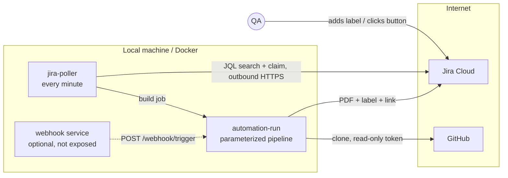

# Architecture

Rules that hold in every route:

- Only mapped Jira keys can start a run; the tag always comes from the tag map.
- Jenkins only makes outbound calls (Jira, GitHub). Nothing public points at Jenkins.
- The reporting step can never change the test result.

## Components

| Component | Where | Role |
|---|---|---|
| `jira-poller` job | Jenkins (`Jenkinsfile.poll` in tests repo) | search Jira, claim tickets, trigger runs |
| `automation-run` job | Jenkins (`Jenkinsfile` in tests repo) | validate params, run tagged scenarios, report |
| `scripts/jira-poll.mjs` | tests repo | search + claim (remove `run-automation`, add `automation-queued`) |
| `scripts/jira-report.mjs` | tests repo | cucumber JSON -> `summary.json` (PASSED/FAILED/NO_TESTS) |
| `scripts/generate-pdf.mjs` | tests repo | `summary.json` -> PDF |
| `scripts/jira-notify.mjs` | tests repo | attach PDF, set result label, update build link, optional comment |
| webhook service | `webhook/` | optional push trigger with secret auth and allowlists |
| JCasC | `jenkins/casc.yaml` | users, permissions, credentials, jobs |
